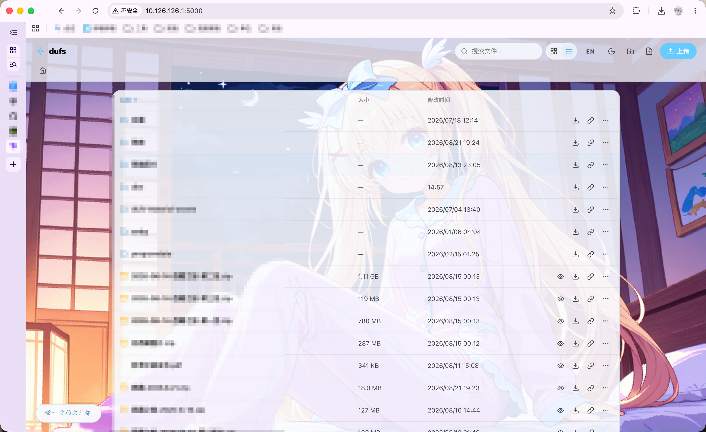

# dufs-extra

A cozy custom frontend UI for [dufs](https://github.com/sigoden/dufs), covering browsing, uploading, previewing and file management.

English · [中文](README.zh-CN.md) 

---

## Preview



## Introduction

[dufs](https://github.com/sigoden/dufs) is a static file server written in Rust. This project provides a complete custom web UI for it.

## Features

- **Browsing**: breadcrumbs, auto-rendered README.md, card / table dual views (preference remembered, auto-falls back to cards on small screens), client-side sorting (natural name sort), server-side search (`?q=`), optional pagination (`config.limit`)
- **Uploading**: drag & drop, multiple files, recursive folders, 5 concurrent tasks with per-file progress; create folders / files
- **File operations**: rename, move, delete (with confirmation), online text editing, ZIP download
- **Detail drawer**: slides in from the right on file/card click — name, type, size, modified time, path, SHA-256 (shown when `--allow-hash` is on), preview area, download and copy-link buttons
- **Copy links**: plain link + shareable token link (`?tokengen` → `?token=`, valid for 3 days)
- **Preview**: images, video, audio, PDF, text/code (Prism), Markdown, subtitles (converted to WebVTT), audio metadata, font viewer; Office / draw.io / JXL are optional toggles
- **Auth**: sign in / out in the top bar (native browser dialog, CHECKAUTH / LOGOUT)
- **Theme**: light / dark (system-following + manual toggle), frosted-glass design system, scroll-progress cat-paw button, typewriter motto
- **i18n**: Chinese / English auto-detection, one-click switch in the top bar, preference persisted

## Usage

This repo is built for dufs **≥ 0.46.0**

Download `dufs-extra.zip` from release, unzip it, then

```bash
dufs --assets dufs-extra
```

## Requirements

- dufs **≥ 0.46.0** (API details follow this version)
- Node.js + pnpm to build the frontend

## Quick start

```bash
pnpm install     # install dependencies
pnpm build       # type-check + build + post-process (vue-tsc + vite + after-build.js)
dufs --assets ./dist   # serve via dufs
```

The `dist/` output is a standard dufs assets directory: asset URLs in `index.html` are rewritten to the `__ASSETS_PREFIX__` placeholder, which dufs fills in at startup.

Open `http://127.0.0.1:5000` (dufs default port). Add flags as needed for write operations:

```bash
dufs --assets ./dist --allow-upload --allow-delete --allow-search --allow-archive --allow-hash
```

## Configuration

Edit `window.__DUFS_MATERIAL_CONFIG__` in `dist/index.html` and redeploy:

```js
window.__DUFS_MATERIAL_CONFIG__ = {
  page: { title: "My Cloud", logo: "/logo.png" },
  footer: "© 2026 …",
  background: { light: "/bg-light.png", dark: "/bg-dark.png" },
  theme: { light: "#66CCFF", dark: "#66CCFF" },
  glassmorphism: { appbar: true, filelist: true, readme: true, preview: true },
  limit: 50,            // pagination; 0/absent = no pagination
  externalViewer: true, // Office / draw.io online previews
  jxlPolyfill: true,    // JXL decoding + Photopea
  preferPreview: true,  // prefer preview over download when opening files
  decorations: true,    // cat-paw button / typewriter motto
  codeHighlightMaxLines: 1000,
  codeHighlightMaxLineLength: 500,
}
```

## Development

```bash
# Build project
pnpm run build

# Start a dufs instance（Port 5000，enable auth / upload / CORS）
dufs --auth admin:admin@/:rw --auth guest:guest@/ --enable-cors --allow-all --assets dist
```

Then open `http://127.0.0.1:5000` to develop against upload, auth and token flows.

## i18n

- Browser language is auto-detected: `zh*` → Chinese, anything else → English
- Toggle with the "中 / EN" button in the top bar; preference stored in `localStorage` (`dufs.lang`)
- Strings live in `src/i18n.ts` — new keys must be added to both the `zh` and `en` dictionaries

## Project layout

```
src/
├── api/            # dufs HTTP API wrapper (IndexData types, requests / writes / auth)
├── components/     # top bar, dual file views, detail drawer, previews, upload overlay, dialogs…
├── composables/    # theme, upload, dialog, toast, entry actions
├── router/         # vue-router (history mode)
├── styles/         # design tokens + base + component styles (lolimeow port)
├── utils/          # file-type detection, formatting, code highlighting, subtitle conversion…
└── i18n.ts         # zh / en dictionaries
```

## License

[MIT License](./LICENSE) @ Vincent-the-gamer 2026-PRESENT
